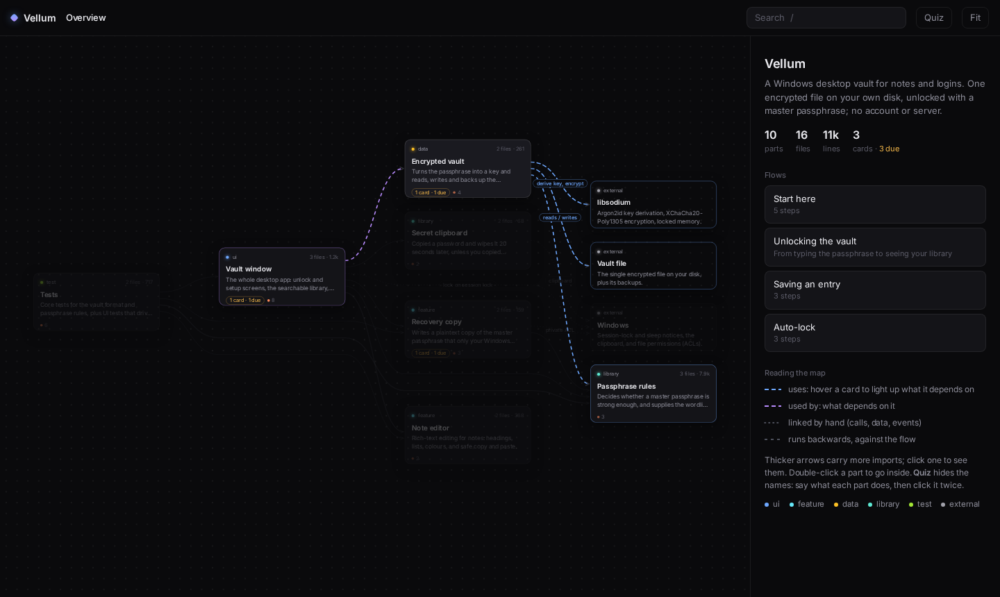
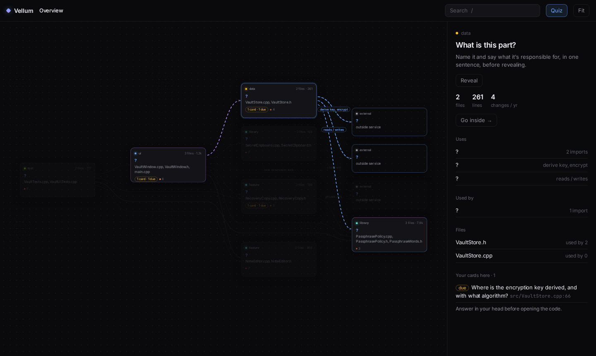
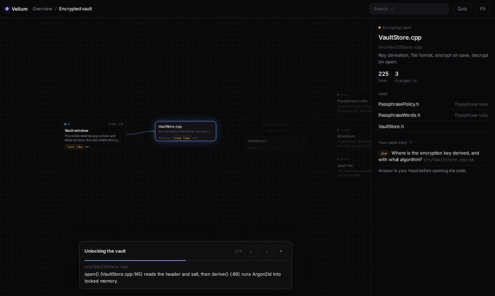
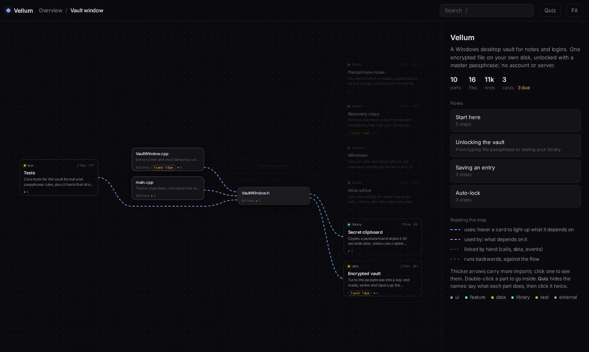
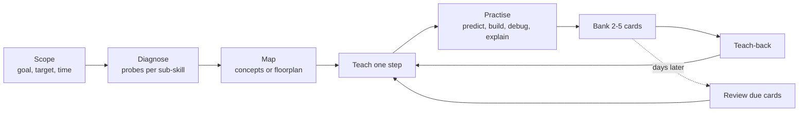

<div align="center">

# sensei

**A Claude Code skill that teaches you instead of answering for you.**

Sensei finds out what you already know, teaches the next step only, makes you recall and apply it, and schedules the review so it sticks. For codebases, it draws you an interactive map you have to earn.

[](https://code.claude.com/docs/en/skills)
[](#install)
[](#how-it-works)
[](#privacy)

[Install](#install) · [Try it](#things-to-say) · [A session](#what-a-session-looks-like) · [Codebases](#learning-a-codebase) · [How it works](#how-it-works) · [FAQ](#faq)

</div>



## Why sensei?

Ask an AI to explain something and you get a good explanation that is gone by next week. Reading feels like learning; it mostly isn't. What builds lasting skill is well researched: **trying before being told, recalling instead of rereading, practising at the edge of your ability, and reviewing on a schedule**.

Sensei makes Claude coach that way:

- **Places you first.** A few probing questions per sub-skill, then a plain statement of where you are (four stages of competence). You're rarely at one stage everywhere.
- **One step at a time.** One concept, one exercise per turn. Attempt before answer, hint before explanation.
- **Production, not recognition.** Predict what code prints, find the bug, design then defend it, explain it to a newcomer.
- **Remembers you.** Spaced-repetition cards (SM-2) and a progress profile persist across sessions, so the next session starts with what's due.
- **Learns codebases properly.** Recon, a floorplan of the system, traced flows, and cards pinned to `file:line` that follow the code when it moves.

## Install

```sh
git clone https://github.com/sacredcodr/claude-skill-sensei
mkdir -p ~/.claude/skills && cp -r claude-skill-sensei/sensei ~/.claude/skills/
```

Start a new Claude Code session. Sensei loads when you ask to learn something, or run `/sensei`. Requires Python 3.9+; nothing else to install.

## Things to say

| Say | What happens |
|---|---|
| "Teach me how Rust lifetimes work" | A probe or two to place you, one concept, one exercise, 2-3 cards banked |
| "Help me learn this codebase well enough to change it" | The full loop: scope, diagnose, recon, floorplan, traced flows, a small real change |
| "Quiz me" / "Review my cards" | Today's due cards, weakest first; you grade yourself honestly, the schedule adapts |
| "What am I learning?" | Every topic with its stage, due cards and next step |
| "Show me the map" | Opens the codebase floorplan, in quiz mode if you haven't earned the names yet |
| "Should I use CQRS here?" | Architecture coaching: forces first, you choose and defend, then trade-offs |

Just want an answer? Ask normally. Sensei stays out of one-off questions.

## What a session looks like

An example, from learning a password-vault codebase:

> **You:** teach me how vellum encrypts the vault
>
> **Sensei:** Before I show you anything: when you type your master passphrase, what do you think the app does with it before it can decrypt the file?
>
> **You:** hashes it and uses the hash as the key?
>
> **Sensei:** Close, and a common first answer. A plain hash is fast, which is exactly what you *don't* want for a passphrase. Open `src/VaultStore.cpp:66`. What function is called there, and what do you notice about its arguments?
>
> **You:** crypto_pwhash with kPasses and kMemory... so it's deliberately slow?
>
> **Sensei:** Yes: Argon2id, slow and memory-hard so guessing is expensive. You found that yourself, so it will stick. Two cards banked:
> - *Why does Vellum use crypto_pwhash rather than a plain hash to derive its key?* `src/VaultStore.cpp:66`
> - *What happens to the key when the vault locks?*
>
> Next: trace what happens on a wrong passphrase. Predict which line fails.

## Learning a codebase

**Recon.** `codemap.py` reports facts to start from: languages, docs, entry points, HTTP endpoints, the internal import graph (most depended-on files, heaviest directory-to-directory imports, two-way tangles), largest files, git hotspots and contributors. It handles Python, JS/TS, Go, Rust and C/C++.

**Floorplan.** Sensei carves the system into 3-9 parts a person would name at a whiteboard (not the folder tree), writes the flows that matter and a short tour, and renders an interactive map. Before you see it, you sketch your own; the gaps become your first cards.

<table>
<tr>
<td width="50%" valign="top">

<p><b>Quiz mode.</b> Names, notes and flow steps are hidden. Say what each part does, then reveal it. The map is the answer key, not the lesson.</p>
</td>
<td width="50%" valign="top">

<p><b>Flows.</b> Step through a real request or event, hop by hop, with <code>file:line</code> in every note. In quiz mode you predict each next hop first.</p>
</td>
</tr>
<tr>
<td valign="top">

<p><b>Inside a part.</b> Its files in the middle, what uses it on the left, what it uses on the right. Hover anything to light up its connections; click an arrow to see the imports behind it.</p>
</td>
<td valign="top">

<p><b>Your cards on the map.</b> Each card sits on the code it covers, with due counts, so you can see which parts you know and which have gone stale.</p>
</td>
</tr>
</table>

**Cards that follow the code.** Each codebase card is anchored to its line. When the code moves, the card is re-pointed; edits elsewhere in the file are ignored; only cards whose own code changed or vanished are flagged for re-checking, together with the line they were written against.

If a repo already has a map from the [Floorplan](https://github.com/haydenschmitty/floorplan) plugin, sensei uses its lookups and tour too.

## How it works



Claude does the coaching; small Python scripts do the bookkeeping so nothing depends on Claude remembering:

| Script | Does |
|---|---|
| `srs.py` | Cards (SM-2 scheduling), profile, stages per sub-skill, session log, ref checking. One call resumes a topic. |
| `codemap.py` | Codebase recon: facts only, interpretation is the learner's job. |
| `floorplan.py` | Validates the map spec, places cards, writes one self-contained HTML map; `show` prints the same connections as text. |

<details>
<summary><b>Repository layout</b></summary>

```
sensei/
  SKILL.md                 the coaching loop Claude follows
  reference/
    stages.md              four stages of competence: diagnosis and coaching moves
    techniques.md          techniques ranked by evidence, exercise formats, card quality
    codebase.md            playbook for learning a repo, and how to carve a floorplan
    floorplan.md           map spec format and in-session moves
    architecture.md        playbook for design and trade-offs
  scripts/
    srs.py  codemap.py  floorplan.py  test_srs.py  test_floorplan.py
  assets/floorplan.html    the map viewer template
```
</details>

## Privacy

Everything stays on your machine. Progress lives in `~/.claude/learning/<topic>/` (set `LEARN_HOME` to move it): `profile.json`, `cards.json`, `map.md` and, for codebases, `floorplan.json` and `floorplan.html`. The scripts make no network requests. The map works offline; when online it loads the Inter font from Google Fonts and falls back to system fonts without it. Card answers are never written into the map.

## FAQ

<details>
<summary><b>Is the four-stages model scientific?</b></summary>

Not really, and sensei says so. Its origin is disputed and its timelines are informal; it is used as a heuristic for choosing the next coaching move. The methods that carry the evidence (retrieval practice, spaced repetition, deliberate practice) are in `sensei/reference/techniques.md`, with their sources and strength of evidence.
</details>

<details>
<summary><b>How long are sessions?</b></summary>

As long as you like. A quick "teach me X" is a few turns. Reviews default to 10 cards and never try to clear a large backlog in one sitting; tell it if you're short on time.
</details>

<details>
<summary><b>What happens when the code changes after I made cards?</b></summary>

On a returning session sensei runs `check-refs`: moved code is re-pointed silently, and only cards whose code really changed are flagged. It re-checks those against the code before asking them, so you're never quizzed on something that's no longer true. Rebuild the map with `floorplan.py build <topic>`.
</details>

<details>
<summary><b>Can I edit the map?</b></summary>

Yes. `~/.claude/learning/<topic>/floorplan.json` is plain JSON: parts, globs, flows, tour, notes. `floorplan.py build <topic>` validates it and names every problem ("did you mean …"). See `sensei/reference/floorplan.md`.
</details>

<details>
<summary><b>Does it work outside Claude Code?</b></summary>

`SKILL.md` follows the Agent Skills format, and the scripts are plain Python, so any agent that loads skills can use it. It is written and tested for Claude Code.
</details>

## Development

```sh
python3 -I sensei/scripts/test_srs.py
python3 -I sensei/scripts/test_floorplan.py
```

The scripts use the standard library only and are tested on Python 3.9, 3.10 and 3.14. Issues and pull requests are welcome.

## Credits

The coaching loop draws on [the four stages of learning](https://scottjeffrey.com/four-stages-of-learning/), Dunlosky et al. (2013) on learning techniques, Ericsson on deliberate practice, and Naur's *Programming as Theory Building*. The floorplan approach (plain-language parts instead of folders, guided flows, a start-here tour, carrying notes across moved code) is inspired by [Floorplan](https://github.com/haydenschmitty/floorplan) by Hayden Smith (MIT); sensei's engine is a separate, smaller implementation that adds quiz mode and spaced-repetition cards.
