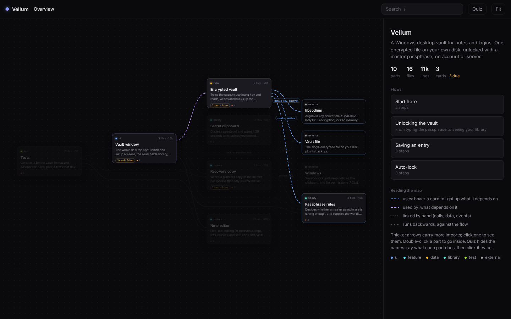

# sensei

A Claude Code skill that coaches you to real mastery of any topic: a codebase, an architecture, a library, a concept.

- Diagnoses your stage per sub-skill (four stages of competence), then teaches the next step only.
- Drives deliberate practice, retrieval and teach-back instead of passive explanation.
- Remembers you: spaced-repetition cards (SM-2) and a progress profile persist across sessions.
- Learns codebases the way they are built: recon, an interactive floorplan of the system, traced flows, and cards pinned to `file:line` that notice when the code moves.



## Install

```sh
mkdir -p ~/.claude/skills && cp -r sensei ~/.claude/skills/
```

Then say "teach me X", "quiz me", "learn this codebase", or run `/sensei`.

State is stored in `~/.claude/learning/<topic>/` (override with `LEARN_HOME`). Scripts need only Python 3; the map is a single HTML file with no dependencies.

## Codebases

**Recon** (`scripts/codemap.py <repo>`): languages, docs, entry points, HTTP endpoints (Flask, FastAPI, Express-style, Go, Spring), the internal import graph (most depended-on files, heaviest directory-to-directory imports, two-way dependencies) for Python, JS/TS, Go, Rust and C/C++, largest files, git hotspots.

**Floorplan** (`scripts/floorplan.py`): the coach carves the system into 3-9 named parts, writes the flows that matter and a short tour, and the script renders an interactive map:

- an overview of parts, and inside each part its files, with the parts that use it on the left and the parts it uses on the right;
- hover or select a card to light up its dependencies (blue) and dependents (violet), animated in the direction of the arrow; click an arrow to see the imports behind it;
- playable flows and a "Start here" tour;
- **quiz mode** hides names and flow notes so the learner recalls each part before revealing it;
- the learner's cards appear on the code they cover, with due counts (questions only, never answers).

```sh
F="python3 -I ~/.claude/skills/sensei/scripts/floorplan.py"
$F init  <topic>          # starter spec from the folder layout
$F build <topic> --open   # validate the spec, write floorplan.html
$F show  <topic> [ref]    # the same connections as text
```

Spec format and session moves: [`sensei/reference/floorplan.md`](sensei/reference/floorplan.md).

**Cards that follow the code**: `srs.py check-refs` re-points cards whose code only moved, ignores edits elsewhere in the file, and reports only cards whose own code changed or vanished, with the line they were anchored on.

## Tests

```sh
python3 -I sensei/scripts/test_srs.py
python3 -I sensei/scripts/test_floorplan.py
```

## Credits

Based on https://scottjeffrey.com/four-stages-of-learning/ plus further research. The stage model's origin is disputed; it is used as a heuristic, and the evidence-backed techniques are listed in `sensei/reference/techniques.md`.

The floorplan approach (plain-language parts instead of folders, guided flows, a start-here tour, carrying notes across moved code) is inspired by [Floorplan](https://github.com/haydenschmitty/floorplan) by Hayden Smith (MIT). Sensei's engine is a separate, smaller implementation that adds quiz mode and spaced-repetition cards; it also uses a Floorplan map when a repo already has one.
